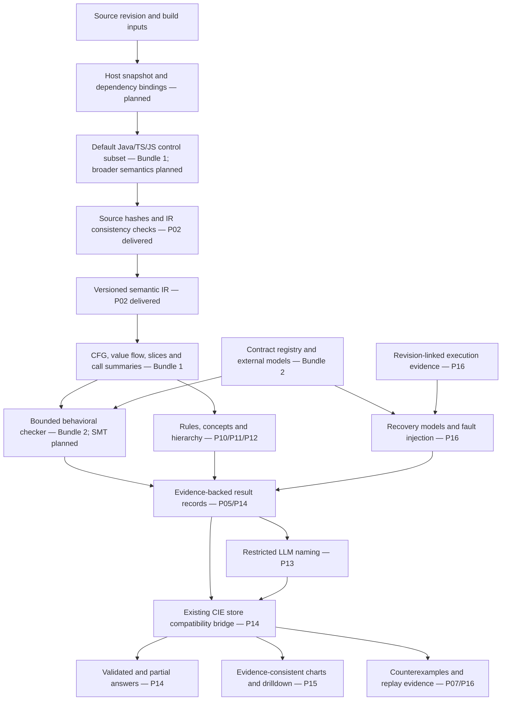
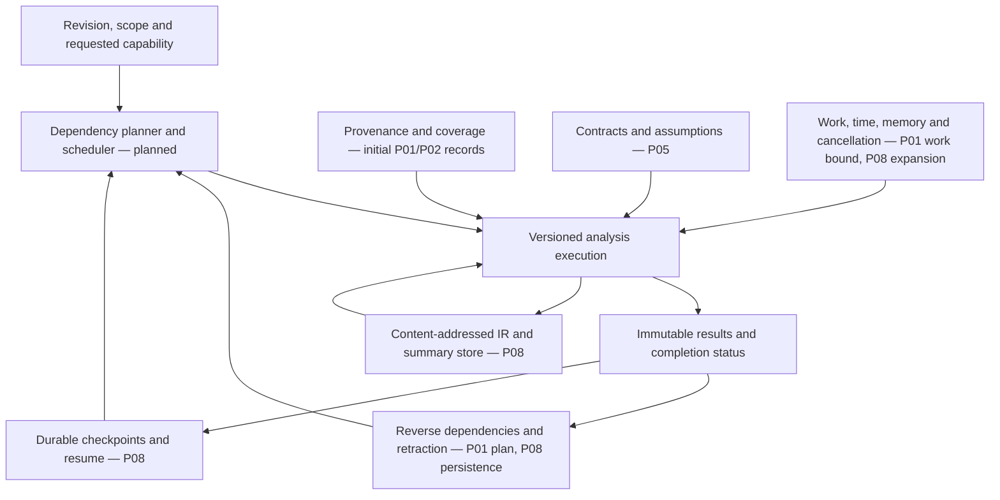
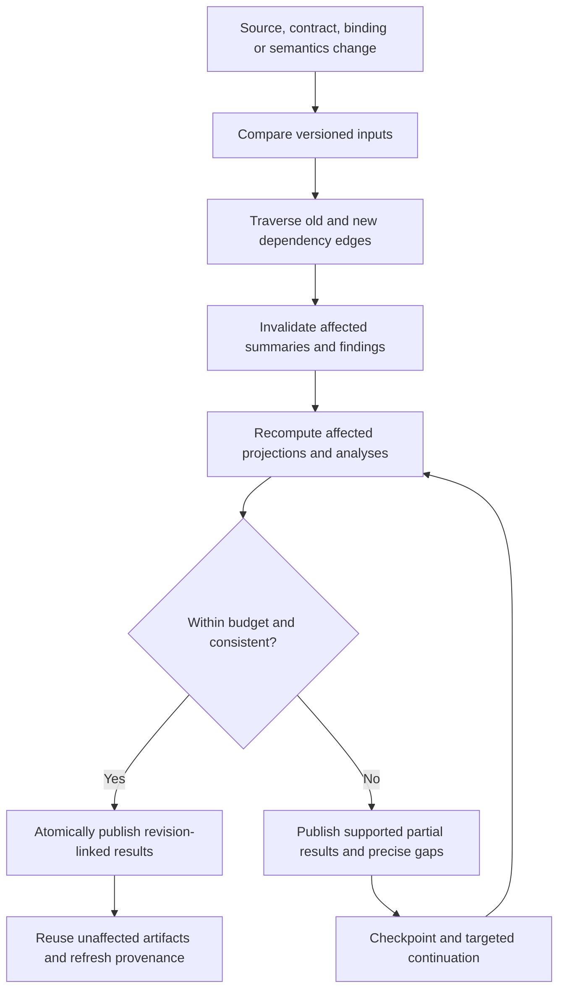
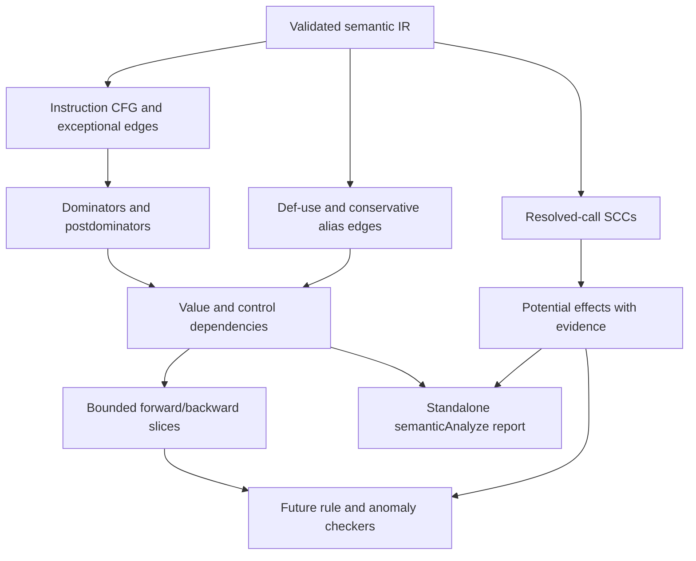
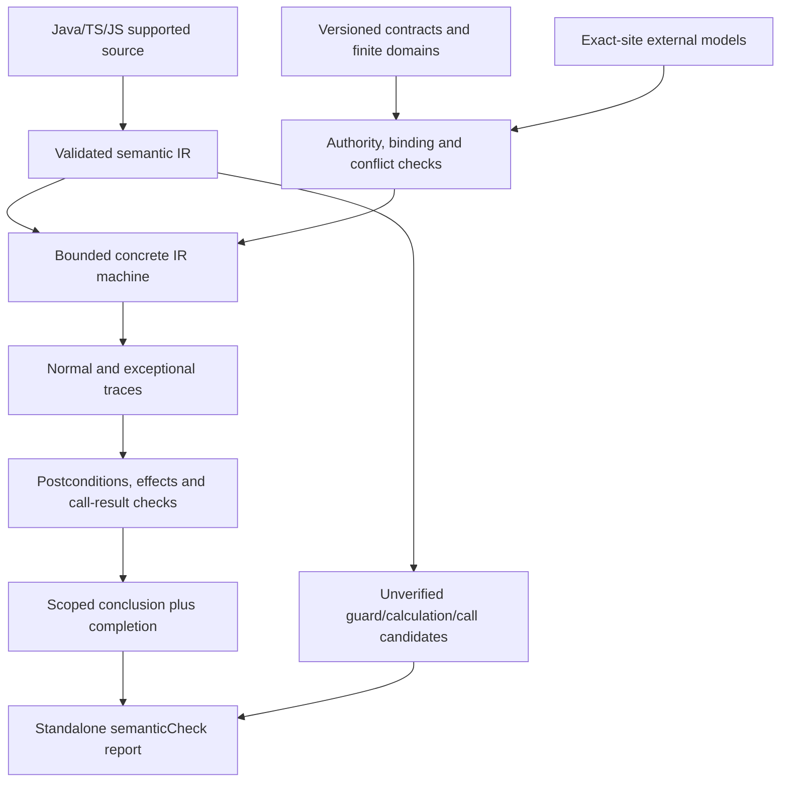

# CIE reusable Rust analysis foundation

Architecture after contracts/behavior Bundle 2, 2026-10-16. Solid status labels below describe delivered
library capabilities, not deployment. All unlabeled future pathways are planned.
The diagrams describe the target architecture; arrows do not imply wiring exists.

## 1. System architecture and trust boundaries

The host supplies authoritative source/build evidence. Rust owns the canonical
analysis representation and reusable computations within supported semantics.
The compatibility bridge preserves existing TypeScript store and application
interfaces. Inference outputs never become source facts without an explicit,
provenance-preserving derivation. LLM naming adds labels only; result identity,
membership and conclusions must remain unchanged.

## 2. Horizontal services shared by every analysis

### Shared service responsibilities

| Service | Common responsibility | Current delivery |
| --- | --- | --- |
| Semantic representation | Typed operations, values, source spans, blocks, call bindings and unknowns | P02 schema and consistency checks; no adapter |
| Source trust gate | Verify supplied bytes, digests, document identities and span ownership | P02; host revision authentication still required |
| Evidence/coverage | Preserve why a result exists and which semantics are missing | P01 summary evidence/gaps; P02 source/binding/gap records |
| Execution kernel | Reusable bounded propagation and later analysis scheduling | P01 represented-effect worklist only |
| Dependency service | Determine which facts/results become stale | P01 old/new reverse-call invalidation plan only |
| Artifact/cache service | Durable reusable IR, projections and summaries with retraction | Planned P08 |
| Contract service | Explicit and inferred obligations, authority, assumptions and conflicts | Planned P05/P10 |
| Result protocol | Distinguish facts, candidates, violations, unknowns and incomplete runs | P01 completion status only; wider protocol P05/P14 |
| Naming service | Read-only semantic input and validated labels | Planned P13 |
| Application bridge | Map results into existing CIE evidence, answers and charts | Planned P14/P15 |

Projections are typed adapters from the same validated IR, not separate parsers.
An algorithm may have its own internal representation, but must retain input
digests, source/evidence links, assumptions and coverage. No universal graph
format is forced onto the solver, FCA lattice and probabilistic hierarchy model.

## 3. Incremental change lifecycle

P01 implements the initial invalidation plan over call edges. P08 must add
persistence, retraction, checkpointing and non-call dependencies. Some changes
will legitimately invalidate an entire repository; there is no general guarantee
of work proportional only to changed files. Incremental/cold equivalence tests
are mandatory for every supported transformation, especially deletions.

## 4. Future needs mapped to reusable components

| Need | Shared foundation reused | Specialized work | Evidence required before claiming success |
| --- | --- | --- | --- |
| Extract actual behavior | Semantic IR, provenance, call identities | Effects, CFG/PDG slicing, composition | Source fidelity and path/unknown coverage |
| Detect fake authorization | Effects, contracts, source links | Conformance checking and feasible counterexamples | Explicit obligation, supported semantics and counterexample |
| Detect ignored rejection | Return/value dependencies and exceptional flow | Caller path analysis | Failure reaches a forbidden downstream action |
| Derive local rules | Exact constants, predicates, typed values | Abstract interpretation/SMT | Scope, assumptions and checking status |
| Infer likely protocols | Call/behavior records and evidence scope | Specification mining | Candidate support; never automatic authority |
| Extract overlapping concepts | Verified attributes and object identities | Local FCA closure/lattice algorithms | Membership derivations and enumeration coverage |
| Build structural hierarchy | Typed relational projections and stable IDs | Baseline comparison and candidate SBM/MDL model | Reviewed grouping quality and measured tradeoffs |
| Incremental concept building | Dependency tracking and artifact hashes | Local context/hierarchy updates | Clean-rebuild agreement and measured latency |
| Name concepts properly | Immutable result records | Restricted LLM labeling | Label validation; analysis unchanged without LLM |
| Investigate stranded debits | Calls, writes, transaction/provider models | Safety/liveness analysis | Actual debit/refund semantics and recovery assumptions |
| Validate recovery failures | Revision-linked behavior and trace evidence | Fault injection, lineage and replay | Failed-refund, crash, interruption and duplicate scenarios |
| Explain a finding | Per-result provenance and coverage | Claim-level answer construction | Every supported claim linked to its evidence |
| Draw relevant charts | Same result snapshot and graph relationships | Chart-specific projections and validation | Unknown steps and revision consistency preserved |
| Continue investigations | Stable work identities and missing evidence | Durable checkpoints and targeted scheduling | Safe resume after interruption and stale-revision handling |
| Support more languages | Shared schema, result protocol and tests | Language/runtime/framework adapters | Construct-by-construct capability and fidelity matrix |
| Assist future code changes | Contracts, dependencies and regression evidence | Separate change planning/generation/approval workflow | Existing feature workflow integration; not delivered here |

These are architectural reuse mappings, not commitments that one analysis solves
all cases. Business bounded contexts require business evidence; program graphs
alone cannot uniquely recover organizational intent. Universal invariants and
eventual recovery require stronger modeling than observed successful tests.

## 5. Implementation boundaries after P02

| Boundary | Status |
| --- | --- |
| P01 unordered operation inventory and represented-effect summaries | Delivered and tested |
| P01 reverse-call invalidation planner | Delivered; no durable cache application |
| P02 semantic IR schema, source byte verification, type/reference checks and digest | Delivered and tested |
| P01 → P02 semantic conversion | Not implemented; no implicit promotion |
| Source → semantic IR adapter | Bundle 1: expressions, invokes, supported branches/loops, throws and simple JS/TS catch; other semantics opaque |
| Semantic IR → CFG/PDG/behavior summaries | Bundle 1: structural projections and potential-effect summaries; must-effects/path proofs pending |
| Contracts, checked conclusions and anomalies | Bundle 2: versioned authority, finite-domain checking and witness traces; SMT pending |
| Rule/concept/hierarchy algorithms | Static unverified candidates delivered; broader P10/P11/P12 pending |
| New results → existing CIE store/answers/charts | P14–P15 pending |
| Runtime validation and distributed recovery checking | P16 pending |

P02 validation: 185 workspace tests passed, including 21 new semantic IR tests;
release build and strict crate Clippy passed. Those tests establish the schema
boundary alone. Current validation after Bundle 2: 285 workspace tests; release
build and strict crate Clippy pass. Checklist: 68 of 190 tasks checked, 122 pending;
task count is not a progress percentage by effort.

## 6. Architectural rules for future patches

1. Preserve source evidence and explicit unknowns through every projection.
2. Keep completion separate from logical conclusions and statistical confidence.
3. Never infer successful business effects from call/resource names alone.
4. Version lowering, language semantics, contracts, models and solver inputs.
5. Do not feed inferred labels or hypotheses back as verified primitive facts.
6. Retraction and deletion handling are part of correctness, not optional cleanup.
7. Make each vertical slice demonstrate source → result before expanding its scope.
8. Reuse existing CIE infrastructure where its actual contracts fit; avoid duplicate
   persistence, job orchestration and evidence stores without a documented reason.
9. Every release specifies supported constructs and analysis assumptions.
10. Update the implementation checklist and evidence ledger with each patch.

## P02a default-language update

Java, TypeScript/TSX and JavaScript/JSX are registered automatically. Adapter files
are discovered at build time; a new language implements the same Rust trait in
one file, with a parser dependency added only when required. Supported semantics
currently cover literal-return bodies; unsupported bodies and module semantics
remain opaque with explicit gaps. The existing CIE indexer and answer/chart routing
are unchanged. Validation now includes 200 workspace tests and independent
Java/Node literal execution comparisons.

## P03a straight-line expression update

Default adapters now lower supported parameter references, local declarations,
reassignment and selected unary/arithmetic/comparison operations. Unsupported
statements invalidate the whole candidate body, retaining an opaque region.
Java wrapping and JS/TS Number behavior have independent source-execution tests;
TypeScript parameter annotations remain explicit model assumptions. Calls,
branches, loops and exception paths are still pending. Workspace validation: 213
tests passed. See the updated checklist for the precise remaining work.

## P03b call and continuation update

Default adapters now preserve call sites, normal continuations and propagated
exceptional exits. Same-class private-static Java targets resolve only under
exact supported signatures; JS/TS targets remain unresolved. Lookup and argument
ordering is retained, and unknown ECMAScript code invalidates local assumptions
(including eval effects). No successful authorization/refund or handler behavior
is inferred. Call v3 invalidates earlier adapter/semantics cache inputs. Validation:
229 workspace tests; branches, loops and exception handlers remain pending.

## Delivered analysis consumer boundary

Joins and loop-carried values are opaque approximations. Simple JS/TS catches
and uncaught throws are supported; Java catch/finally remain opaque. Must-effects
and full logical path conditions are pending. No product answer/chart routing or
persistent incremental cache is enabled by this bundle. Original P01–P19
workstreams now ship as five larger bundles, tracked in the checklist.

## Bundle 2 — executable contract checking

A violation requires a stored concrete witness under the declared model. A
satisfaction result covers only the finite input/outcome domain. Unknown provider
semantics, opaque joins, conflicts and exhausted bounds remain explicit gaps.
Hypotheses/test observations stay candidates; model provenance and version remain
assumptions. Protocol ordering also checks completed exceptional paths.
SMT/inductive proofs, wider rule mining, concept hierarchy and product routing
remain planned. Primary Bundle 2 patch includes earlier P03b/Bundle 1 work missing
from freshly pulled upstream `f902662`; the alternative incremental patch applies
after Bundle 1. Apply one alternative.
